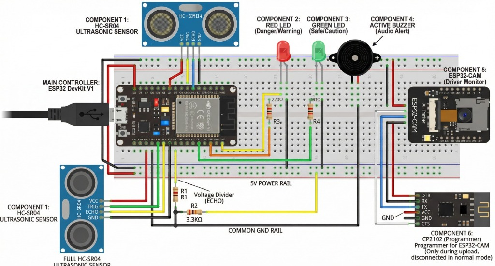
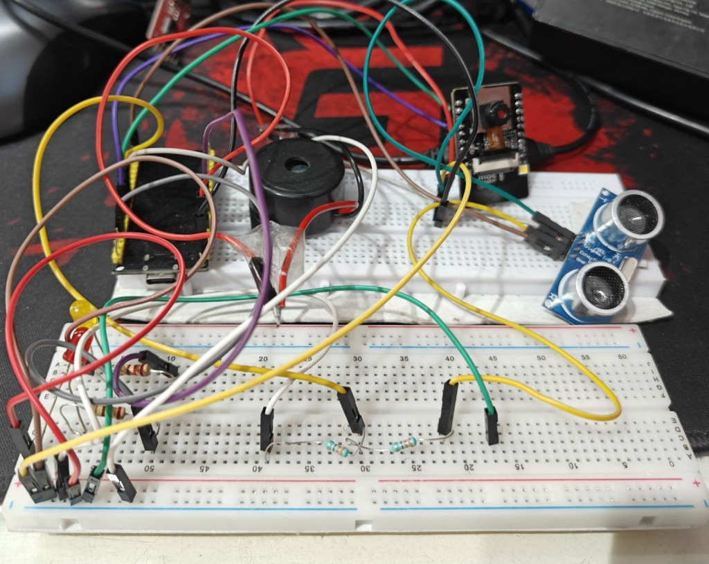
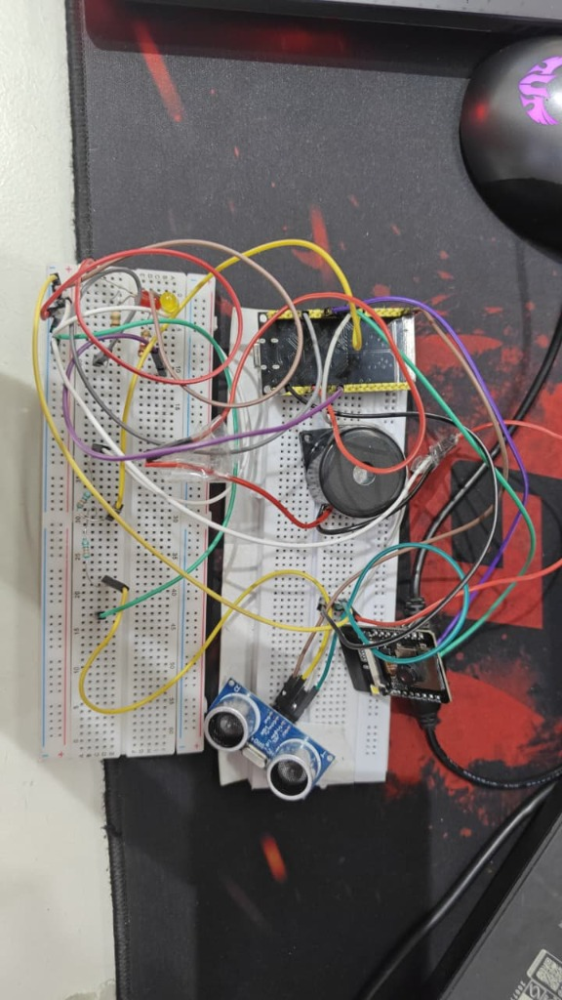

# IoT-Enabled Advanced Driver Assistance System (ADAS) with Drowsiness Detection

[](LICENSE)
[](https://www.espressif.com/)
[](https://www.arduino.cc/)
[-26A5E4.svg)](https://core.telegram.org/bots/api)
[](https://www.ddu.ac.in/)

A modular, low-cost embedded vehicle safety system integrating **forward-collision obstacle detection**, **acoustic/visual proximity alerts**, **vision-based driver drowsiness monitoring**, and **bidirectional IoT telematics via the Telegram Bot API**.

---

## 📸 Hardware Prototype & Schematic

| Circuit Schematic (Fritzing) | Breadboard Hardware Implementation |
| :---: | :---: |
|  |  |

<p align="center">
  
  <br />
  <em>Top-down view showing ESP32 DevKit, ESP32-CAM module, HC-SR04 ultrasonic sensor, active buzzer, indicators, and resistor networks.</em>
</p>

---

## 🌟 Key Highlights & Engineering Features

* **Dual-Layer Architecture**: Strict decoupling of safety-critical local alert loops (**5 Hz / 200 ms**) from network-dependent cloud communications (**0.2 Hz / 5000 ms**) ensuring sub-200 ms emergency braking warnings even under network loss.
* **10-Sample Moving Average Filter**: Circular buffer data smoothing on acoustic time-of-flight measurements with outlier rejection to suppress deflection artifacts and surface bounce.
* **4-Tier Proximity Zone Classification**: Context-aware graduated response matrix (**Danger**, **Warning**, **Caution**, and **Safe**) driving active buzzer frequencies and dual LEDs.
* **Lightweight Vision Motion Algorithm**: Local edge-based 20-zone (5×4) spatial grid frame-difference motion tracking running on an **ESP32-CAM (OV2640)** in QQVGA (160×120) without reliance on heavy AI/ML runtimes.
* **Bidirectional IoT Telematics**: End-to-end TLS-encrypted command-and-control via **Telegram Bot API** supporting remote status queries, on-demand distance sampling, trip statistics, and remote arming/disarming.
* **Hardware Protection**: Dedicated resistive voltage divider ($3.3\,\text{k}\Omega + 3.3\,\text{k}\Omega$) shifting 5V HC-SR04 ECHO pulses to safe $2.5\,\text{V}$ logic levels for ESP32 GPIO inputs.

---

## 🏗️ System Architecture

```text
 ┌────────────────────────────────────────────────────────────────────────┐
 │                              SENSING LAYER                             │
 ├────────────────────────────────────┬───────────────────────────────────┤
 │     HC-SR04 Ultrasonic Sensor      │        ESP32-CAM (OV2640)         │
 │   (Forward Obstacle Detection)     │   (Driver Face & Motion Frame)    │
 └─────────────────┬──────────────────┴─────────────────┬─────────────────┘
                   │ Echo Pulse (5V)                    │ QQVGA Grayscale
                   ↓                                    │ (160x120 @ 10fps)
      ┌─────────────────────────┐                       │
      │ 3.3k / 3.3k Divider     │                       │
      │ (Shifts 5V → 2.5V Logic)│                       │
      └────────────┬────────────┘                       │
                   │                                    │
 ┌─────────────────┴────────────────────────────────────┴─────────────────┐
 │                   PROCESSING & ALGORITHM ENGINE                        │
 ├────────────────────────────────────┬───────────────────────────────────┤
 │         ESP32 DevKit V1            │             ESP32-CAM             │
 │  • 10-Sample Moving Average Filter │  • 20-Zone Grid Spatial Analysis  │
 │  • Outlier Boundary Rejection      │  • Frame-Difference Motion Metric │
 │  • 4-Zone Proximity State Machine  │  • Stillness / Drowsy Detection   │
 │  • Non-Blocking millis() Timers    │  • Telegram Alert Generator       │
 └─────────────────┬──────────────────┴─────────────────┬─────────────────┘
                   │                                    │
 ┌─────────────────┴──────────────────┬─────────────────┴─────────────────┐
 │       REAL-TIME ACTUATION (5 Hz)   │      BACKGROUND IOT LAYER (0.2 Hz)│
 ├────────────────────────────────────┼───────────────────────────────────┤
 │ • Red LED (Fast / Slow Alert Blink)│ • Wi-Fi Station (802.11 b/g/n)    │
 │ • Green LED (Caution / Solid Safe) │ • Telegram Bot API (HTTPS / TLS)  │
 │ • 5V Active Buzzer (Acoustic Alarm)│ • Remote Commands: /status, /arm  │
 └────────────────────────────────────┴───────────────────────────────────┘
```

---

## 🔬 Software Algorithms & Logic

### 1. Moving Average Filter & Outlier Rejection
Ultrasonic pulses are prone to multipath reflections and surface deflection. A 10-sample circular buffer smooths incoming readings while discarding out-of-bound spikes:

$$\text{Distance}_{\text{smoothed}} = \frac{1}{N} \sum_{i=0}^{N-1} \text{readings}[i], \quad N = 10$$

```cpp
float getSmoothedDistance() {
  float newReading = measureRawDistance();
  // Outlier filter: retain last valid sample if out-of-bounds
  if (newReading < 0 || newReading > 450) {
    newReading = readings[(readIndex - 1 + NUM_READINGS) % NUM_READINGS];
  }
  runningTotal -= readings[readIndex];
  readings[readIndex] = newReading;
  runningTotal += newReading;
  readIndex = (readIndex + 1) % NUM_READINGS;
  return runningTotal / (float)NUM_READINGS;
}
```

### 2. 4-Zone Proximity Classification Matrix

| Proximity Zone | Distance Range | Red LED | Green LED | Active Buzzer | Telegram Cloud Alert |
| :--- | :--- | :--- | :--- | :--- | :--- |
| **🚨 DANGER** | $< 20\text{ cm}$ | Fast Blink (150 ms) | OFF | Rapid Tone (150 ms) | `🚨 COLLISION DANGER!` |
| **⚠️ WARNING** | $20 - 50\text{ cm}$ | Slow Blink (500 ms) | OFF | Slow Tone (500 ms) | `⚠️ PROXIMITY WARNING` |
| **🟡 CAUTION** | $50 - 100\text{ cm}$ | OFF | Blink (800 ms) | Silent | `ℹ️ Caution Zone` |
| **🟢 SAFE** | $> 100\text{ cm}$ | OFF | Solid ON | Silent | `✅ Path Clear` |

*Note: Telegram alerts trigger strictly on zone transitions to prevent network flooding.*

### 3. Edge Drowsiness Detection (20-Zone Motion Tracking)
Instead of executing resource-intensive DNN/OpenCV facial landmark tracking, the ESP32-CAM segments the 160×120 QQVGA frame into a **$5 \times 4$ spatial matrix (20 zones)**:
1. Computes mean pixel luminance $L_{current}[i]$ for each zone $i \in [0, 19]$.
2. Calculates absolute difference: $\Delta L[i] = |L_{current}[i] - L_{previous}[i]|$.
3. Increments active zone count if $\Delta L[i] > 15$ (luminance threshold).
4. If $\text{ActiveZones} \ge 3$, motion is registered and timer resets.
5. If no motion is detected for $> 3.0\text{ s}$ ($\text{DROWSY\_TIMEOUT}$), micro-sleep state triggers onboard flash illumination and dispatches a Telegram emergency alert.

---

## ⚡ Hardware Pinout & Circuit Analysis

### ESP32 DevKit V1 Pin Assignments

| Pin | Direction | Connected Device | Function |
| :--- | :--- | :--- | :--- |
| **GPIO 5** | OUTPUT | HC-SR04 TRIG | $10\,\mu\text{s}$ ultrasonic pulse trigger |
| **GPIO 18** | INPUT | HC-SR04 ECHO (via divider) | Acoustic time-of-flight echo return |
| **GPIO 4** | OUTPUT | Red LED (via $220\,\Omega$) | Hazard alert indicator |
| **GPIO 15** | OUTPUT | Green LED (via $220\,\Omega$) | Safe condition indicator |
| **GPIO 13** | OUTPUT | Active Buzzer | Audible acoustic alarm |
| **5V / VIN** | POWER | HC-SR04 VCC, ESP32-CAM VCC | $5\,\text{V}$ power rail |
| **GND** | POWER | Common Ground | Unified system ground reference |

### Voltage Divider Calculation
The HC-SR04 operates at $5\,\text{V}$ logic, while ESP32 GPIOs tolerate a maximum of $3.3\,\text{V}$. Two identical $3.3\,\text{k}\Omega$ resistors step down the echo signal:

$$V_{out} = V_{in} \times \left(\frac{R_2}{R_1 + R_2}\right) = 5\,\text{V} \times \left(\frac{3.3\,\text{k}\Omega}{3.3\,\text{k}\Omega + 3.3\,\text{k}\Omega}\right) = 2.50\,\text{V}$$

$2.5\,\text{V}$ is safely within the $0\text{--}3.3\,\text{V}$ GPIO operating envelope and comfortably above the $2.0\,\text{V}$ digital HIGH threshold.

---

## 📲 Telegram Bot Remote Command Interface

The system integrates bidirectional control via the `UniversalTelegramBot` library:

| Command | Action | Sample Response |
| :--- | :--- | :--- |
| `/status` | Queries live zone, distance, uptime, and free heap | `📊 ADAS Status: 🟢 SAFE \| Dist: 132.4 cm \| Heap: 288 KB` |
| `/distance` | Executes 3-sample burst ultrasonic scan | `📏 Active Distance Scan: 42.1 cm` |
| `/arm` | Arms physical acoustic alarms & LEDs | `🔔 System ARMED: Acoustic alerts active.` |
| `/disarm` | Mutes buzzer alarms (visual alerts persist) | `🔕 System DISARMED: Buzzer muted.` |
| `/stats` | Fetches trip hazard event counter | `📈 Trip Stats: Danger Events: 4 \| Warning Events: 12` |
| `/help` | Lists command options | Interactive command catalog |

---

## 📊 Experimental Results & Benchmarks

| Metric | Measured Value | Evaluation & Impact |
| :--- | :--- | :--- |
| **Hardware Alert Latency** | **$< 200\text{ ms}$** | Real-time response at 5 Hz deterministic cycle |
| **Distance Measurement Accuracy** | **$\pm 1.5\text{ cm}$** | Verified across 5 cm to 400 cm range against calibrated scale |
| **Telegram Alert Latency** | **$1.5\text{ to }3.0\text{ s}$** | Dependent on cellular/Wi-Fi carrier network latency |
| **Program Storage (Flash)** | **$\approx 8\text{--}10\%$** | Substantial headroom for OTA and secondary modules |
| **Dynamic Memory (SRAM)** | **$\approx 6\%$** | $> 90\%$ heap available, zero memory leak over 48h burn-in |

---

## 🛠️ Bill of Materials (BOM)

| S.No. | Component Description | Specification | Quantity |
| :--- | :--- | :--- | :--- |
| 1 | ESP32 DevKit V1 | Dual-Core 240 MHz, 520 KB SRAM, Wi-Fi/BLE | 1 |
| 2 | ESP32-CAM AI-Thinker | OV2640 2MP Camera, Onboard Flash LED | 1 |
| 3 | HC-SR04 Ultrasonic Sensor | 40 kHz, $2\text{--}400\,\text{cm}$ range | 1 |
| 4 | Active Buzzer | 5V Self-oscillating ($2300\,\text{Hz}$) | 1 |
| 5 | Red & Green Diffused LEDs | 5 mm, 20 mA forward current | 2 |
| 6 | Current Limiting Resistors | $220\,\Omega$, $0.25\,\text{W}$ | 2 |
| 7 | Voltage Divider Resistors | $3.3\,\text{k}\Omega$, $0.25\,\text{W}$ | 2 |
| 8 | CP2102 / CH340 USB-TTL Converter | FTDI Programmer for ESP32-CAM | 1 |
| 9 | Solderless Breadboard & Jumpers | 830-point breadboard + M-M jumpers | 1 |

---

## 🚀 Getting Started & Flashing

### 1. Prerequisites
* Install [Arduino IDE 2.x](https://www.arduino.cc/en/software).
* Install the **ESP32 by Espressif Systems** board package in Board Manager (`v2.0.x` or `v3.0.x`).
* Install library dependencies:
  * `UniversalTelegramBot` by Brian Lough
  * `ArduinoJson` (v6.x)

### 2. Flashing the ADAS Main Controller
1. Open [`firmware/ADAS_Main_Controller/ADAS_Main_Controller.ino`](firmware/ADAS_Main_Controller/ADAS_Main_Controller.ino).
2. Configure your Wi-Fi SSID, Password, Telegram `BOT_TOKEN`, and `CHAT_ID`.
3. Select board: **DOIT ESP32 DEVKIT V1**.
4. Connect via micro-USB and upload.
5. Open Serial Monitor at **115200 baud** to verify distance calibration.

### 3. Flashing the ESP32-CAM
1. Connect ESP32-CAM via CP2102 USB-TTL converter (TX $\to$ U0R, RX $\to$ U0T, 5V $\to$ 5V, GND $\to$ GND).
2. **Short GPIO 0 to GND** to enter flashing bootloader mode.
3. Open [`firmware/Drowsiness_Detection_CAM/Drowsiness_Detection_CAM.ino`](firmware/Drowsiness_Detection_CAM/Drowsiness_Detection_CAM.ino).
4. Select board: **AI Thinker ESP32-CAM**.
5. Upload sketch, remove the GPIO 0 jumper, and press the onboard RESET button.

---

## 👥 Contributors & Academic Credits

Project developed as part of the Electronics and Communication Engineering curriculum at **Dharmsinh Desai University (DDU)**, Nadiad.

* **Abhi Shah** ([@Abhi191005](https://github.com/Abhi191005)) – Embedded C++ firmware architecture, moving-average digital filter implementation, non-blocking multitasking scheduler, and hardware prototyping.
* **Sahilali Dholkawala** – ESP32-CAM vision integration, 20-zone motion difference algorithm tuning, and testing.
* **Sanghani Karan** – Circuit design, voltage divider safety validation, Telegram Bot API integration, and performance benchmarking.

---

## 📄 License
This project is licensed under the [MIT License](LICENSE).
